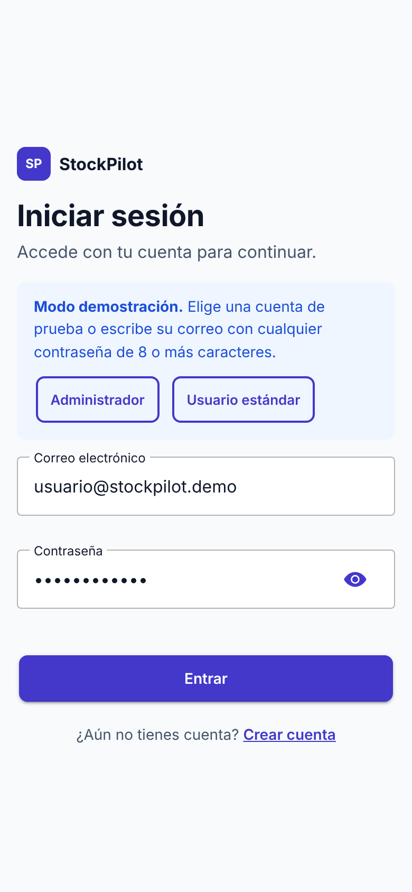
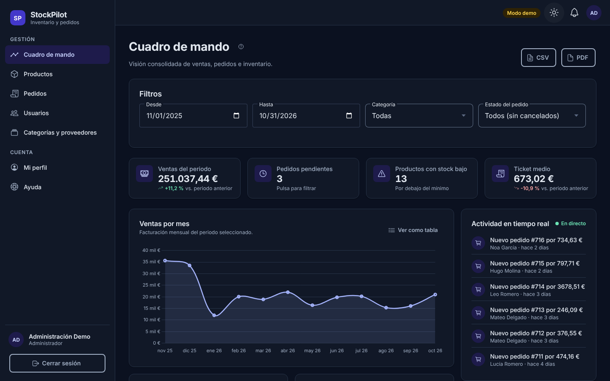
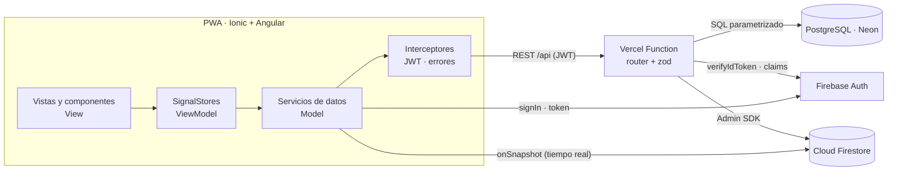

# StockPilot · Gestión de inventario y pedidos

Aplicación de gestión empresarial **multiplataforma (PWA)** desarrollada con **Ionic 9 + Angular 22** para el módulo _Desarrollo de Interfaces (0488)_ de 2º DAM.

Una distribuidora ficticia gestiona su inventario, sus pedidos, sus proveedores y sus usuarios. El **Administrador** cuenta con un cuadro de mando en tiempo real y el **Usuario estándar** con un catálogo para hacer pedidos.


|           Catálogo en móvil           |                Modo oscuro                |           Detalle de pedido            |
| :-----------------------------------: | :---------------------------------------: | :------------------------------------: |
|  |  |  |

> **Datos 100 % sintéticos.** Nombres, correos (dominios reservados `example.com` y `.demo`) y cifras son ficticios. No se usa ningún dato personal real.

---

## Índice

1. [Funcionalidades](#funcionalidades)
2. [Stack y arquitectura](#stack-y-arquitectura)
3. [Estructura del proyecto](#estructura-del-proyecto)
4. [Puesta en marcha local](#puesta-en-marcha-local)
5. [Variables de entorno](#variables-de-entorno)
6. [Scripts](#scripts)
7. [Calidad: tests, accesibilidad y documentación](#calidad-tests-accesibilidad-y-documentación)
8. [Git Flow](#git-flow)
9. [CI/CD y despliegue](#cicd-y-despliegue)
10. [Seguridad](#seguridad)
11. [Manual de usuario](#manual-de-usuario)

---

## Funcionalidades

| Área                                                                       |        Administrador        | Usuario estándar |
| -------------------------------------------------------------------------- | :-------------------------: | :--------------: |
| Cuadro de mando con KPIs, 4 gráficos interactivos y filtros en tiempo real |             ✅              |        —         |
| Feed de actividad en tiempo real (Firestore)                               |             ✅              |        —         |
| Productos: búsqueda, filtros, orden y paginación                           |           ✅ CRUD           |   ✅ Consulta    |
| Pedidos: crear, listar y ver detalle                                       | ✅ Todos + cambio de estado |    ✅ Propios    |
| Usuarios: alta con validación asíncrona y cambio de rol                    |             ✅              |        —         |
| Categorías y proveedores                                                   |           ✅ CRUD           |        —         |
| Exportación a **PDF** (con diseño) y **CSV**                               |             ✅              |        ✅        |
| Notificaciones en tiempo real, perfil, modo oscuro y ayuda contextual      |             ✅              |        ✅        |

## Stack y arquitectura

| Capa                | Tecnología                                                                                                                |
| ------------------- | ------------------------------------------------------------------------------------------------------------------------- |
| Interfaz            | Ionic 9 (componentes standalone), Angular 22 _zoneless_, signals, `OnPush` en todos los componentes                       |
| Estado              | **NgRx SignalStore**: `AuthStore` global y un store por página (`DashboardStore`, `ProductsStore`, `OrdersStore`…)        |
| Asincronía          | RxJS: `forkJoin`, `combineLatest`, `switchMap`, `debounceTime` y `rxMethod`                                               |
| Formularios         | Reactive Forms tipados, validadores síncronos, de grupo, de `FormArray` y **asíncronos contra la API**                    |
| API REST + SQL      | Función serverless de Vercel (`api/router.ts`), **PostgreSQL en Neon**, validación con **zod** y consultas parametrizadas |
| Tiempo real (NoSQL) | **Cloud Firestore** (`activity`, `notifications`) con reglas de seguridad por rol                                         |
| Identidad           | **Firebase Authentication**: el token JWT se verifica en el servidor en cada petición                                     |
| Gráficos e informes | Chart.js (registro selectivo), jsPDF + autotable (carga diferida) y CSV RFC 4180                                          |
| Calidad             | Vitest, PGlite (PostgreSQL en memoria), Playwright, axe-core, Lighthouse CI, ESLint, Prettier, commitlint                 |
| Documentación       | Compodoc (cobertura ≥ 90 %), manual integrado en la app                                                                   |

### Diagrama



**MVVM.** Las vistas solo presentan datos y emiten eventos. Los _SignalStores_ guardan el estado y exponen `computed` y acciones. Los servicios encapsulan el acceso a la API REST y a Firestore. Los componentes compartidos (`app-data-table`, `app-kpi-card`, `app-chart-card`…) son agnósticos a la vista: reciben datos con `input()` y notifican con `output()` y `model()`.

**Seguridad en las rutas.** Las rutas usan guards `canMatch` (`authGuard`, `roleGuard` y `guestGuard`), de modo que el chunk diferido de una ruta no se descarga si el usuario no tiene permiso. Además, **la API vuelve a comprobar el rol en cada endpoint**. La fuente de verdad del rol es PostgreSQL y se replica como _custom claim_ para las reglas de Firestore.

**Modo demostración.** Si no hay configuración de Firebase (por ejemplo, en desarrollo, en los tests E2E o en Lighthouse CI), la app usa un backend simulado en memoria que aplica las mismas reglas de negocio. Así la aplicación se puede probar sin cuentas externas y nunca muestra una pantalla en blanco por falta de configuración.

## Estructura del proyecto

```
api/                      Función serverless (Vercel) y librería de la API
  router.ts               Punto de entrada único (/api/* → router)
  _lib/                   app (rutas), repositorios SQL, zod, Firebase Admin, HTTP
db/schema.sql             Esquema relacional con claves foráneas, índices y CHECK
scripts/                  set-env, seed (Neon + Firebase), iconos, servidor SPA local
src/app/
  core/                   auth, guards, interceptores, servicios, modelos, utilidades, demo
  shared/components/      data-table, kpi-card, chart-card, page-header, field-error…
  features/               auth, dashboard, products, orders, users, masters, profile, help, errors
  layout/shell/           split-pane, menú lateral, barra superior y notificaciones
tests/api/                Tests de la API contra PostgreSQL en memoria
e2e/                      Playwright (flujos, control de acceso y axe-core)
docs/                     Manual de usuario, guía de despliegue y capturas
.github/workflows/        CI (calidad, E2E, seguridad) y Deploy (Vercel)
```

## Puesta en marcha local

Requisitos: **Node.js 22+**.

```bash
npm ci
npm start              # http://localhost:4200 en modo demostración (sin cuentas externas)
```

En modo demostración puedes entrar con los botones **Administrador** o **Usuario estándar** de la pantalla de inicio de sesión.

Para usar los servicios reales (Firebase + Neon), crea `.env` a partir de `.env.example` y sigue la guía [docs/PUESTA_EN_MARCHA.md](docs/PUESTA_EN_MARCHA.md). Para probar también la API en local: `npx vercel dev`.

## Variables de entorno

Están todas documentadas en [`.env.example`](.env.example). Ninguna se versiona:

- `FIREBASE_*`: configuración web de Firebase. `scripts/set-env.mjs` la inyecta en el build y genera `src/environments/environment.ts`, que está en `.gitignore`.
- `FIREBASE_SERVICE_ACCOUNT_BASE64` y `DATABASE_URL`: solo para el servidor (Vercel).
- `SEED_*`: credenciales de las cuentas de prueba que crea `npm run seed`. Solo existen en tu `.env` local.

## Scripts

| Script                                         | Descripción                                                                 |
| ---------------------------------------------- | --------------------------------------------------------------------------- |
| `npm start`                                    | Servidor de desarrollo                                                      |
| `npm run build`                                | Build de producción (PWA con _service worker_)                              |
| `npm run build:e2e`                            | Build de producción en modo demostración                                    |
| `npm test` / `npm run test:coverage`           | Tests unitarios (Vitest)                                                    |
| `npm run test:api`                             | Tests de la API contra PostgreSQL en memoria (PGlite)                       |
| `npm run test:e2e`                             | Tests E2E con Playwright + axe-core (escritorio y móvil)                    |
| `npm run lint` · `npm run format:check`        | ESLint (incluye reglas de accesibilidad) y Prettier                         |
| `npm run docs:build` · `npm run docs:coverage` | Documentación Compodoc y su cobertura (≥ 90 %)                              |
| `npm run lhci`                                 | Auditoría Lighthouse CI                                                     |
| `npm run seed`                                 | Carga los datos sintéticos en Neon y Firestore y crea las cuentas de prueba |

## Calidad: tests, accesibilidad y documentación

- **Tests unitarios:** utilidades, validadores, guards, interceptores, `AuthStore`, servicios, backend de demostración y componentes `DataTable` y `KpiCard`.
- **Tests de la API:** autenticación, autorización por rol, transacciones de pedidos con _rollback_, estadísticas, restricciones SQL y datos de _seed_, contra un PostgreSQL real en WebAssembly.
- **E2E:** login y redirecciones, 403 por rol, validación asíncrona, creación de pedido, cambio de estado, búsqueda, exportación a PDF y CSV, ayuda contextual y auditoría **axe-core WCAG 2.2 AA** en escritorio y móvil.
- **Accesibilidad:** contraste AA en modo claro y oscuro, tipografía en `rem`, enlace «Saltar al contenido», foco visible, navegación completa por teclado, `aria-live` en avisos y búsquedas, tablas semánticas con `aria-sort`, alternativa en tabla para cada gráfico y `prefers-reduced-motion`.
- **Lighthouse (local, build de producción):** Accessibility **100**, Best Practices **100** y SEO **100**, tanto en móvil como en escritorio.
- **Documentación técnica:** Compodoc, generado en el pipeline y publicado en `/docs` del propio despliegue.

## Git Flow

- `main`: código en producción. Solo admite merges desde `release/*` o `hotfix/*` mediante Pull Request con el CI en verde.
- `develop`: integración. Cada funcionalidad se desarrolla en `feature/*` y se integra con un PR.
- Ramas usadas: `feature/project-setup`, `feature/routing-auth`, `feature/forms-validation`, `feature/shared-components`, `feature/data-services`, `feature/dashboard`, `feature/exports`, `feature/responsive-a11y`, `feature/help-docs`, `chore/ci-cd` y `release/1.0.0`, más la etiqueta `v1.0.0`.
- Los mensajes siguen **Conventional Commits** y se validan con commitlint en un _hook_ de husky.

## CI/CD y despliegue

- **`ci.yml`**: en cada Pull Request y push ejecuta lint, formato, tipos de la API, tests unitarios con cobertura, tests de la API, cobertura de documentación, build, E2E + axe, Lighthouse CI, **gitleaks** (secretos en todo el historial) y `npm audit`.
- **Despliegue en Vercel conectado a GitHub**: cada PR genera una _preview_ y cada commit en `main` se publica en producción. La rama `main` está **protegida**: solo admite Pull Requests con los tres jobs del CI en verde, así que un test fallido bloquea el despliegue.
- **`deploy.yml`**: tras cada despliegue correcto, comprueba que las rutas principales y `/docs` responden 200.
- **`vercel.json`**: build de la app y de Compodoc (`/docs`), _rewrites_ de la SPA (recargar cualquier ruta funciona), una sola función para toda la API y cabeceras de seguridad (CSP, HSTS, `X-Content-Type-Options`, `Referrer-Policy`, `Permissions-Policy`, COOP).

## Seguridad

- No hay secretos en el repositorio. `.env` y el entorno generado están en `.gitignore`, y gitleaks bloquea el pipeline si encuentra alguno.
- Se verifica el JWT y se autoriza por rol **en el servidor**. Un usuario estándar recibe 404 al pedir pedidos ajenos, para no revelar que existen.
- Todas las entradas se validan con zod. Las consultas SQL son parametrizadas y la base de datos tiene restricciones `CHECK`, claves foráneas y unicidad.
- Los pedidos son transaccionales: se bloquean las filas con `FOR UPDATE`, se comprueba el stock y se hace _rollback_ si algo falla.
- Firestore deniega todas las escrituras desde el cliente salvo marcar las propias notificaciones como leídas.
- Los endpoints públicos tienen limitación de peticiones. Los CSV exportados neutralizan fórmulas para evitar inyección CSV.

## Manual de usuario

- **En la aplicación:** sección **Ayuda** y botón **?** en la cabecera de cada pantalla, que abre la ayuda contextual.
- **En Markdown:** [docs/MANUAL_USUARIO.md](docs/MANUAL_USUARIO.md).

---

Proyecto académico de Guillermo Torres · 2º DAM · Desarrollo de Interfaces (0488).
