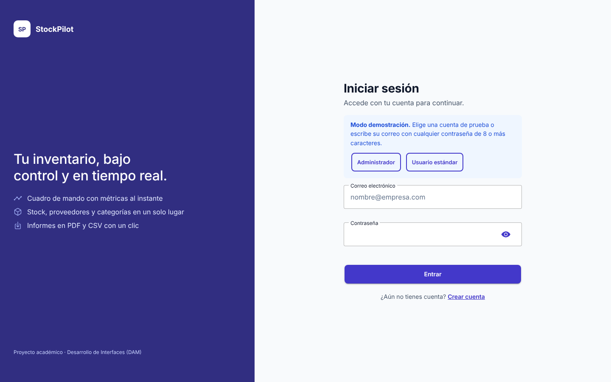
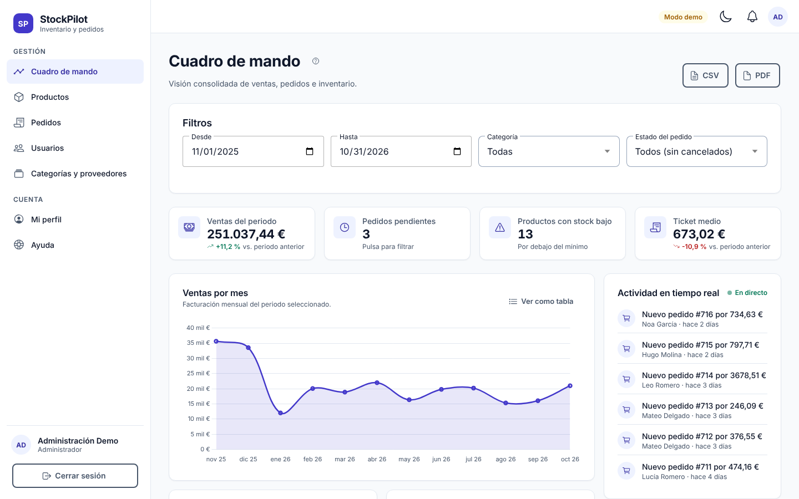
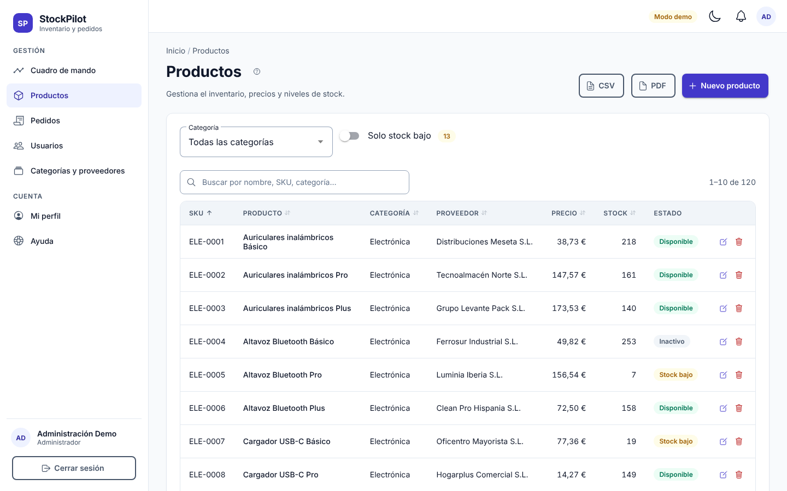
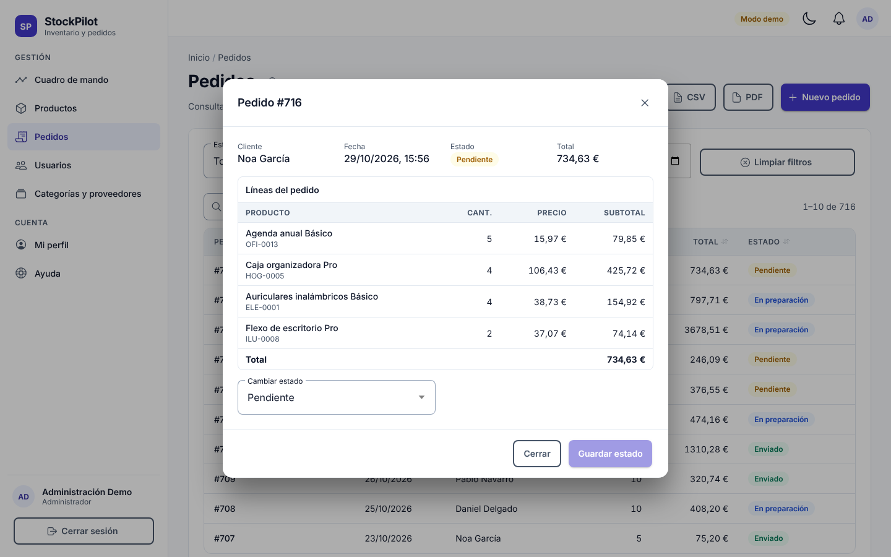
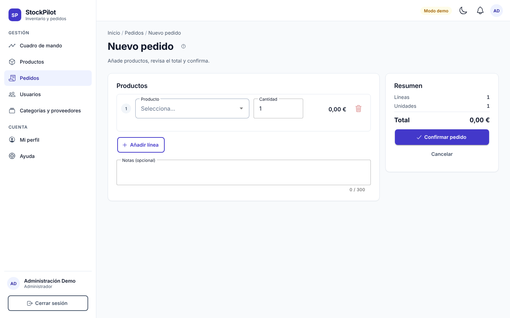
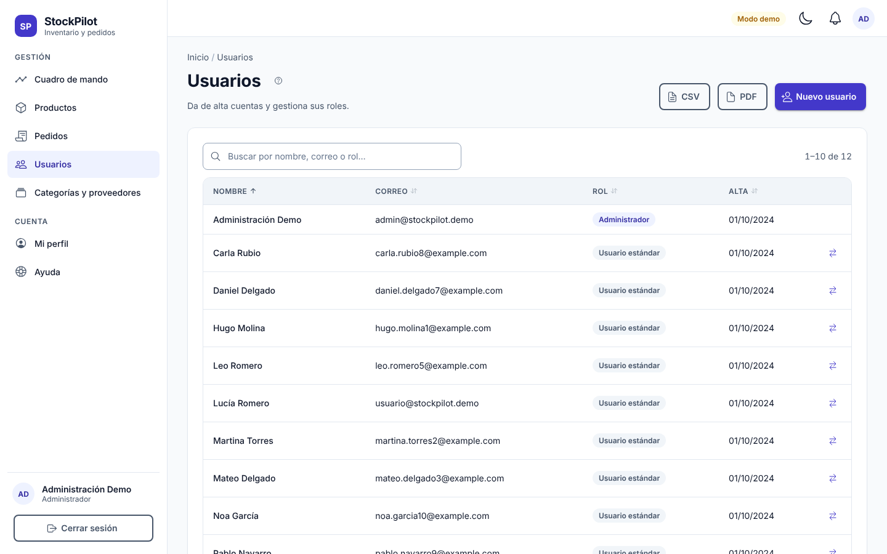

# Manual de usuario · StockPilot

StockPilot es una aplicación para gestionar el inventario, los pedidos y los proveedores de una distribuidora. Funciona en el navegador del ordenador, la tablet o el móvil, y también se puede instalar como aplicación (PWA).

> Este manual también está integrado en la aplicación: sección **Ayuda** del menú y botón **?** junto al título de cada pantalla.

## Índice

1. [Acceso y roles](#1-acceso-y-roles)
2. [Navegación](#2-navegación)
3. [Cuadro de mando (Administrador)](#3-cuadro-de-mando-administrador)
4. [Productos y catálogo](#4-productos-y-catálogo)
5. [Pedidos](#5-pedidos)
6. [Crear un pedido](#6-crear-un-pedido)
7. [Usuarios (Administrador)](#7-usuarios-administrador)
8. [Categorías y proveedores (Administrador)](#8-categorías-y-proveedores-administrador)
9. [Exportar informes](#9-exportar-informes)
10. [Perfil, notificaciones y tema](#10-perfil-notificaciones-y-tema)
11. [Accesibilidad y teclado](#11-accesibilidad-y-teclado)
12. [Preguntas frecuentes](#12-preguntas-frecuentes)

---

## 1. Acceso y roles

1. Abre la aplicación e introduce tu **correo** y tu **contraseña**.
2. Si no tienes cuenta, pulsa **Crear cuenta**. Recibirás el rol **Usuario estándar**.
   - El correo se comprueba en el momento: si ya existe, el formulario te avisa antes de enviarlo.
   - La contraseña debe tener al menos 8 caracteres, con una mayúscula, una minúscula y un número.
3. Al entrar, el **Administrador** llega al Cuadro de mando y el **Usuario estándar** al Catálogo.

| Rol                  | Puede                                                                                                          |
| -------------------- | -------------------------------------------------------------------------------------------------------------- |
| **Administrador**    | Ver el cuadro de mando, gestionar productos, pedidos, usuarios, categorías y proveedores, y exportar informes. |
| **Usuario estándar** | Consultar el catálogo, crear pedidos, seguir sus pedidos, exportarlos y editar su perfil.                      |

Si intentas abrir una sección para la que tu rol no tiene permiso, verás la página **Acceso denegado (403)**.

## 2. Navegación

- **Escritorio:** el menú lateral está siempre visible.
- **Móvil y tablet:** pulsa el botón de menú (☰) de la barra superior.
- La barra superior incluye el **modo claro/oscuro**, las **notificaciones** y el acceso a **Mi perfil**.
- Las migas de pan («Inicio / Pedidos / Nuevo pedido») indican dónde estás y permiten volver atrás.

## 3. Cuadro de mando (Administrador)

- **Indicadores (KPI):** ventas del periodo, pedidos pendientes, productos con stock bajo y ticket medio. Las flechas comparan cada cifra con el periodo anterior de la misma duración.
- **Filtros:** rango de fechas, categoría y estado del pedido. Todo se recalcula al momento. Pulsa **Restablecer** para volver a los últimos 12 meses.
- **Gráficos interactivos:**
  - _Ventas por mes_ (líneas) y _Productos más vendidos_ (barras).
  - _Pedidos por estado_ y _Stock por categoría_: **haz clic en una barra o en un sector para filtrar** por ese valor. Vuelve a pulsarlo para quitar el filtro.
  - Botón **Tabla** en cada gráfico: muestra los mismos datos como tabla (útil para lectores de pantalla).
- **Pedidos pendientes:** al pulsar esta tarjeta se filtra por pedidos pendientes.
- **Actividad en tiempo real:** el panel lateral se actualiza solo cuando se crean pedidos, cambia un estado o un producto baja de su stock mínimo. Cuando llega un pedido nuevo, los indicadores se recalculan automáticamente.

## 4. Productos y catálogo

- **Buscar:** escribe en el buscador (nombre, SKU, categoría, proveedor…). La búsqueda no distingue tildes ni mayúsculas.
- **Filtrar:** por categoría y con **Solo stock bajo**.
- **Ordenar:** pulsa la cabecera de una columna (ascendente → descendente → sin orden).
- **Paginación:** botones **Anterior** y **Siguiente** al pie de la tabla.
- **Estados:** _Disponible_, _Stock bajo_ (unidades iguales o inferiores al mínimo) e _Inactivo_.

**Administrador:**

1. Pulsa **Nuevo producto**, o el icono de editar de una fila.
2. Rellena SKU (formato `ABC-0001`), nombre, categoría, proveedor, precio, stock y stock mínimo. El SKU se comprueba al momento para evitar duplicados.
3. Pulsa **Crear producto** o **Guardar cambios**.
4. Para eliminar un producto, usa el icono de papelera. Si el producto ya figura en pedidos, desactívalo en lugar de eliminarlo.

## 5. Pedidos

- El Usuario estándar ve **sus** pedidos; el Administrador ve **todos**.
- Puedes filtrar por **estado** y por **fechas**, y buscar por número, cliente o estado.
- Pulsa una fila (o selecciónala con el tabulador y pulsa **Intro**) para abrir el **detalle**.

**Cambiar el estado (Administrador):** en el detalle, elige _Pendiente_, _En preparación_, _Enviado_ o _Cancelado_ y pulsa **Guardar estado**.

- Al **cancelar**, las unidades vuelven al stock.
- Un pedido cancelado ya no puede cambiar de estado.
- El cliente recibe una notificación con cada cambio.

## 6. Crear un pedido

1. Ve a **Pedidos › Nuevo pedido**, o pulsa **Nuevo pedido** en el catálogo.
2. En cada línea, elige el **producto** y la **cantidad**. Añade más líneas con **Añadir línea**.
3. La cantidad no puede superar el stock disponible, y un producto no puede repetirse en dos líneas.
4. Revisa el **Resumen** (líneas, unidades y total) y pulsa **Confirmar pedido**.

## 7. Usuarios (Administrador)

- **Nuevo usuario:** nombre, correo (validado al momento), contraseña segura y rol.
- **Cambiar rol:** usa la acción de la fila. Por seguridad, no puedes cambiar tu propio rol.

## 8. Categorías y proveedores (Administrador)

- Cambia entre **Categorías** y **Proveedores** con las pestañas superiores.
- Puedes crear, editar y eliminar registros. Un registro con productos asociados no se puede eliminar.

## 9. Exportar informes

Los botones **CSV** y **PDF** están en Productos, Pedidos, Usuarios y el Cuadro de mando.

- Siempre se exporta **lo que estás viendo**: se respetan la búsqueda, los filtros y el orden.
- **CSV:** compatible con Excel en español (separador `;`, codificación UTF-8).
- **PDF:** incluye cabecera con el logotipo, título, filtros aplicados, fecha y autor, tabla con filas alternas, totales y numeración «Página X de Y».
- Nombre de los archivos: `stockpilot_<sección>_<AAAA-MM-DD>.csv|pdf`.

## 10. Perfil, notificaciones y tema

- **Mi perfil:** consulta tu rol y tu fecha de alta, y cambia tu nombre visible.
- **Notificaciones** (campana): avisos en tiempo real, como cambios de estado de tus pedidos o, para el Administrador, alertas de stock bajo. Pulsa una notificación para marcarla como leída.
- **Modo oscuro:** botón luna/sol de la barra superior o interruptor en Mi perfil. La preferencia se recuerda en ese navegador.

## 11. Accesibilidad y teclado

| Acción                               | Tecla                                          |
| ------------------------------------ | ---------------------------------------------- |
| Avanzar / retroceder entre elementos | `Tab` / `Mayús` + `Tab`                        |
| Saltar directamente al contenido     | Primer `Tab` al cargar → «Saltar al contenido» |
| Abrir el detalle de una fila         | `Intro`                                        |
| Cerrar diálogos y menús              | `Esc`                                          |

La aplicación funciona con lectores de pantalla (etiquetas semánticas y atributos ARIA), anuncia los avisos y los resultados de búsqueda, y admite zoom del navegador hasta el 200 % sin perder contenido.

## 12. Preguntas frecuentes

**No puedo eliminar un producto.** Figura en algún pedido. Desactívalo con el interruptor **Activo en el catálogo**.

**El formulario dice que el correo o el SKU ya existe.** La comprobación se hace contra la base de datos mientras escribes. Usa otro valor.

**No veo el Cuadro de mando.** Es exclusivo del rol Administrador.

**¿Puedo instalar la aplicación?** Sí. En Chrome o Edge usa la opción **Instalar aplicación** de la barra de direcciones; en el móvil, **Añadir a pantalla de inicio**.
